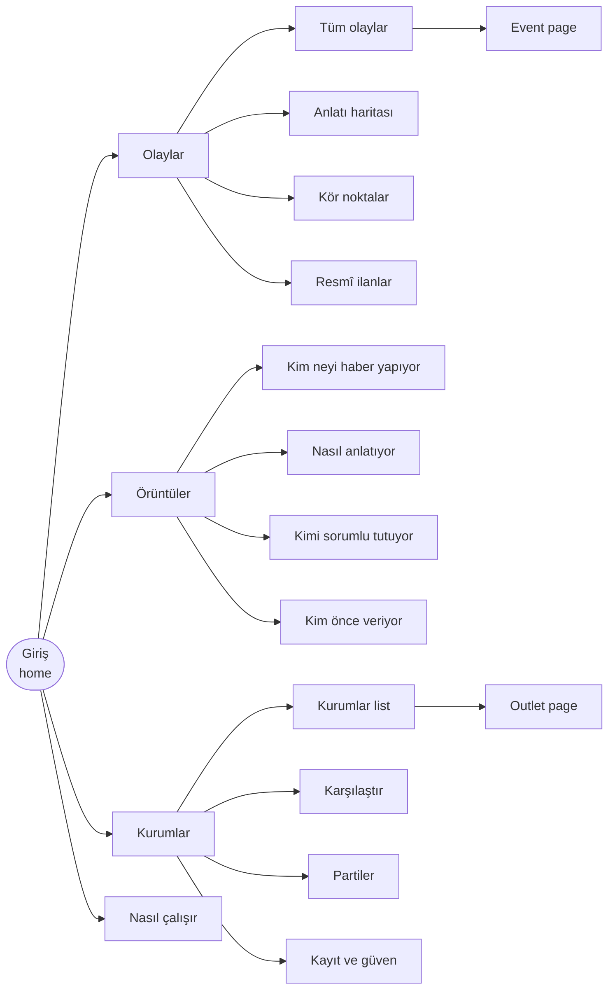
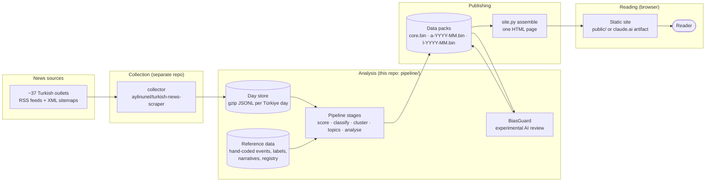
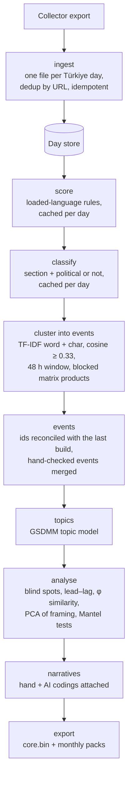
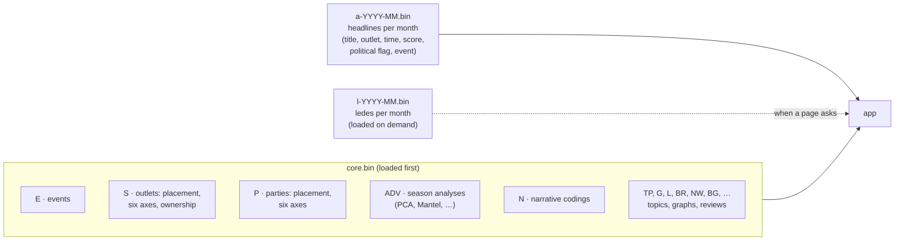
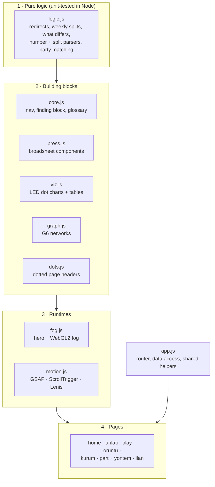
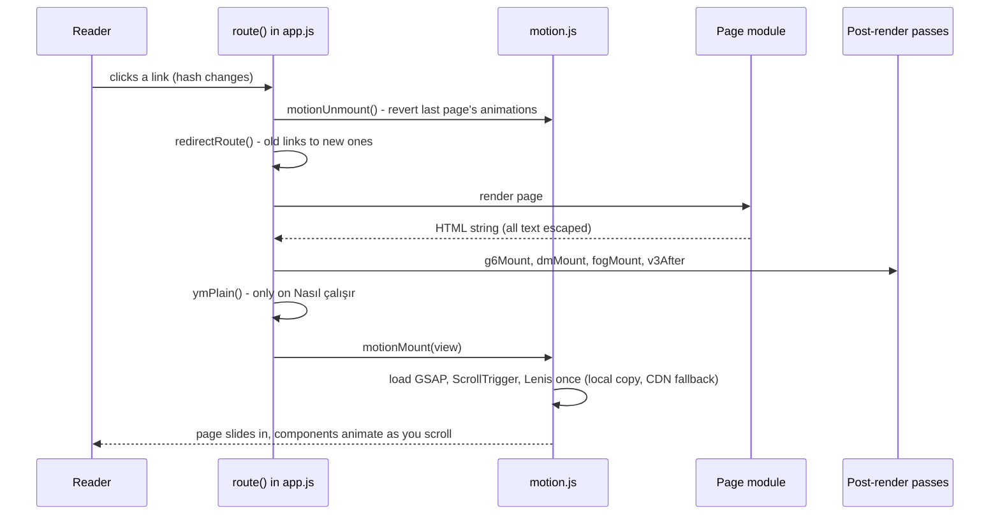
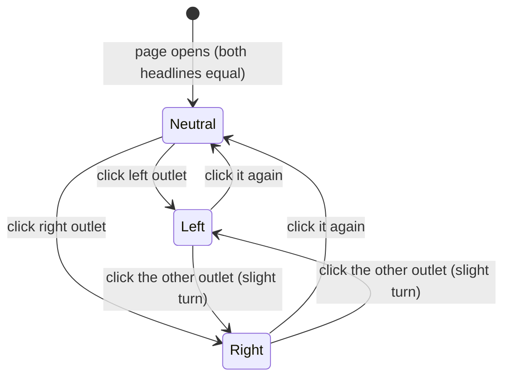
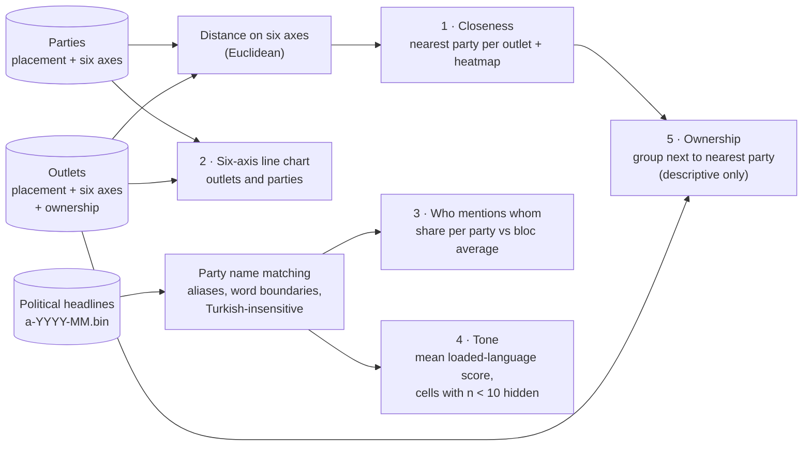
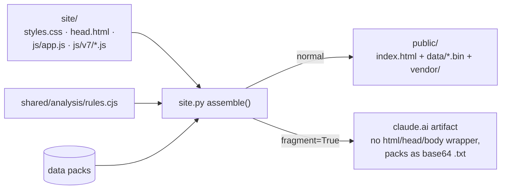
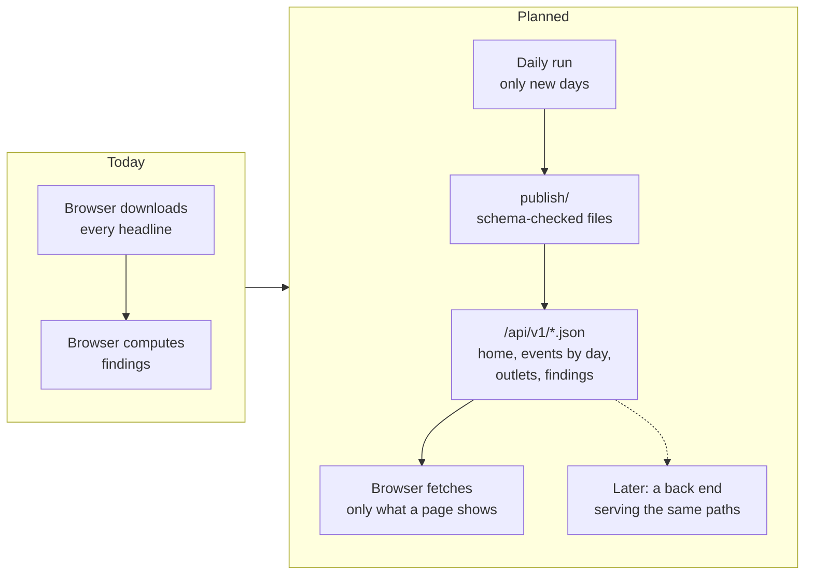

<div align="center">

# Çapraz Manşet

**Aynı olay, farklı manşet.** · *Same event, different headline.*

A static website that puts Turkish news outlets' headlines about the **same event** side by side,
marks the words where they differ, and measures whether those differences repeat across a whole season of news.
It does not judge who is right. It shows who wrote what, and how.

</div>

---

## What is new in 8.1

The collector ([`aylinunel/turkish-news-scraper`](https://github.com/aylinunel/turkish-news-scraper), 72-publisher registry) now supplies 51 outlets through 13 November. Every analysis was recomputed and the site has a page, **8.1’de yeni** (`#/yenilikler`), comparing each result with 8.0. `python -m capraz_pipeline.whatsnew --old <8.0 core.bin> --new <8.1 core.bin>` regenerates it. Anlatı haritası covers 1–13 November (AI-coded, marked YZ); BiasGuard still reviews only the 8.0 events. A Parti is a minor party and never ranks as an outlet's nearest party.

---

## Contents

**For everyone**
- [In one minute](#in-one-minute)
- [Why this exists](#why-this-exists)
- [What is on the site](#what-is-on-the-site)
- [Limits and responsible use](#limits-and-responsible-use)

**For builders**
- [System architecture](#system-architecture)
- [The analysis pipeline](#the-analysis-pipeline)
- [Data packs](#data-packs)
- [Front-end architecture](#front-end-architecture)
- [Page lifecycle](#page-lifecycle)
- [The motion system](#the-motion-system)
- [Outlets and parties analysis](#outlets-and-parties-analysis)
- [Build and publish](#build-and-publish)
- [Quick start](#quick-start)
- [Rebuilding the data](#rebuilding-the-data)
- [Testing](#testing)
- [Accessibility and performance](#accessibility-and-performance)
- [Methods in brief](#methods-in-brief)
- [Project structure](#project-structure)
- [Roadmap: the scalable architecture](#roadmap-the-scalable-architecture)
- [Provenance and licence](#provenance-and-licence)

---

## In one minute

1. **We collect** every headline that about 37 Turkish news outlets publish (388,760 headlines from 51
   outlets between 1 September and 13 November 2026; 8.0 had 245,935 from 33 outlets).
2. **We group** headlines that report the same thing into **events** (9,230 of them).
3. **We compare** how each outlet wrote its headline: which words differ, how loaded the language is,
   who is blamed, who reported first.
4. **We publish** one website that shows this per event, per outlet, per party and as season-long patterns,
   with the method and its limits written out.

Nothing on the site is typed in by hand: every number is computed from the data, and every
machine-made judgement is labelled as such.

---

## Why this exists

When something happens in Türkiye, dozens of outlets publish it within hours, and they rarely say it the
same way. One calls a man a *"Holding Yönetim Kurulu Başkanı"*, another an *"İş insanı"*. One names who is
responsible, another leaves it out. One leads with the fact, another with the outrage.

Reading a single outlet hides these choices. **Çapraz Manşet** ("cross headline") makes them visible and
answers plain questions with numbers:

| Question | Where on the site |
|---|---|
| Who reports what? Which events does one side of the spectrum barely cover? | Örüntüler › *Kim neyi haber yapıyor* |
| How is it told? How loaded is the language, and where do outlets diverge? | Örüntüler › *Nasıl anlatıyor* |
| Whom do the headlines hold responsible? | Örüntüler › *Kimi sorumlu tutuyor* |
| Who reports first, and is the headline harsher than the story's own lede? | Örüntüler › *Kim önce veriyor* |
| How close is each outlet to each party, and how does it write about them? | Kurumlar › *Partiler* |

It is written for three kinds of readers at once:

- **Everyday news readers** get one plain sentence and one picture per finding.
- **Students and teachers** get "why it matters" and what a pattern does *not* mean.
- **Journalists and researchers** get the exact statistics, the method notes and a data table behind every chart.

### The data at a glance

| | |
|---|---|
| **Window** | 1 September – 13 November 2026 (Türkiye time) |
| **Headlines** | 388,760 from 51 outlets (240,683 with a lede), no sampling |
| **Events** | 9,230 groups of headlines about the same thing (9,090 automatic, 140 hand-checked) |
| **Parties** | 19 parties placed on the same six ideological axes as the outlets |
| **Placement** | each outlet's 0–100 position in a supplied registry: below 45 is left, above 55 is right (not independently verified) |
| **Validation** | event clustering pair-F1 0.847 against hand-made reference events; event-topic micro-F1 0.755 (`docs/build-report.json`) |

---

## What is on the site



| Section | In plain words |
|---|---|
| **Giriş (home)** | The biggest split of the week: two outlets' headlines on the same event, side by side, with the words they share in the middle. Click an outlet label and the scene tints to its side. Below it, this week's most differently told events. |
| **Olaylar** | Every event with search and filters; the **Anlatı haritası** (how outlets framed one event: which actor, which cause, which solution, as a flow, a network or a table, with a full explainer); events one side barely covered (*kör noktalar*); a finder for official notices (*resmî ilanlar*). |
| **Event page** | Every headline about the event, a short summary (*Kısaca*), the numbers in it, what all outlets agree on, where they split, who was first. |
| **Örüntüler** | Four questions, each answered by a few findings. Every finding reads in three layers: a claim, a chart, then *Nasıl ölçtük?* with the statistics and the data table. |
| **Kurumlar** | Pick an outlet for its summary and patterns; compare any two; **Partiler** for outlets ↔ parties (closeness on six axes, who mentions which party, tone, ownership). |
| **Nasıl çalışır** | A plain methodology paper: data, event detection, loaded language, narrative coding, AI review, Türkiye context, glossary, coverage, limits and references. |

---

## System architecture

The whole system is a **batch pipeline that writes static files**, and a **static website that reads them**.
There is no server and no database at run time.



| Part | Owns | Hands on |
|---|---|---|
| **Collector** (other repo) | fetching feeds and sitemaps | raw run files |
| **Pipeline** (`pipeline/`) | the day store, every analysis stage, the data bundle | data packs |
| **Shared scorer** (`shared/analysis/rules.cjs`) | the loaded-language rules; runs in the pipeline (Node) and in the browser | a 0–100 score per headline |
| **BiasGuard** (`biasguard/`) | experimental AI review of the most covered events | review results, labelled **YZ** |
| **Site** (`site/`) | pages, charts, motion, design system | one generated `index.html` |

---

## The analysis pipeline



- **Incremental where it is cheap.** Scores and classifications are cached per day (`derived.py`), so a rebuild
  only re-scores new days. Clustering and the season-wide analyses still run over the whole window.
- **Stable identities.** Event ids are reconciled with the previous build, so links to events survive rebuilds.
- **One scorer.** The same `rules.cjs` scores headlines in the pipeline and in the browser's headline analyser.
- Stage details: [`pipeline/README.md`](pipeline/README.md) and [ADR-0002](docs/adr/0002-analysis-pipeline.md).
  Every parameter lives in `pipeline/capraz_pipeline/config.py` and is published on *Nasıl çalışır*.

---

## Data packs

The site reads three kinds of gzip-compressed JSON column packs from `public/data/`.



| Pack | Holds | When it loads |
|---|---|---|
| `core.bin` | events, outlets, parties, season analyses, codings, graphs | at start |
| `a-YYYY-MM.bin` | every headline of that month | at start (all months) |
| `l-YYYY-MM.bin` | the lede (first paragraph) of each story | only when a page needs ledes |

A new build only replaces these files; the page itself carries no data.

---

## Front-end architecture

The site is one hash-routed single page written in plain JavaScript, with no framework and no build step
beyond concatenation. The modules in `site/js/v7/` are joined in a fixed order (`V7_ORDER` in
`pipeline/capraz_pipeline/site.py`) and inlined into `index.html` together with `app.js`.



| Module | Responsibility |
|---|---|
| `logic.js` | pure, unit-tested functions: redirects, weekly splits, "what differs", outlet summaries, Turkish suffixes, glossary, `pNums` (numbers in a sentence), `pSplitPoints` (points of difference), party distance and name matching |
| `core.js` | navigation, the **finding block** (claim → chart → *Nasıl ölçtük?* → table), glossary popovers |
| `graph.js` | G6 networks: agenda similarity, who follows whom, blame |
| `viz.js` | dot, interval and dumbbell rows, distributions, line charts and data tables, drawn as LED dots |
| `dots.js` | dot-matrix engine for the page-header bands and the feed-card effect |
| `fog.js` | the homepage hero: both headlines, the shared band, click-to-tint, WebGL2 fog |
| `press.js` | broadsheet components: section head, lead with drop cap, number tickets, shared band, split accordion, glass |
| `motion.js` | the motion runtime: library loader, smooth scroll, per-page animation lifecycle |
| `home.js`, `anlati.js`, `olay.js`, `oruntu.js`, `kurum.js`, `parti.js`, `yontem.js`, `ilan.js` | one module per page |

**Design system.** Off-white paper and near-black ink, Inter for text, Newsreader for headings and leads,
IBM Plex Mono for numbers and labels. Placement colours are fixed across the site (left `#E11D48`, right
`#2563EB`, centre grey). Every colour is a CSS variable with light and dark values.

---

## Page lifecycle

Every navigation runs the same sequence. Animations from the previous page are torn down before the new
page is drawn, so nothing leaks between pages.



If the motion libraries cannot load, every component is already in its final, readable state, and the
page works with plain scrolling.

---

## The motion system

Components announce themselves with a `data-m="kind"` attribute; `motion.js` keeps one animation recipe per
kind in a registry (`MOTION_K`) and runs them inside one context per page.

| Kind | Used for | Behaviour |
|---|---|---|
| `head` | section heads | rule draws across, title rises word by word |
| `lead` | lead paragraphs | drop cap scales in, words darken as you scroll |
| `tickets` | numbers pulled from a sentence | cards pin under the nav while counters run; always show the exact figure outside that range |
| `common` | what all outlets agree on | left and right sides slide in towards a shared band |
| `splits` | points of difference | accordion of panels coloured by side |
| `scene` | findings | claim pins while its chart draws |
| `cascade` | cards (feed, outlets, notices, glossary) | staggered rise and 3D tilt under the pointer |
| `glass` | atmosphere | frosted squares that flicker |
| `foot` | footer | three dots merge into the logo and a ring draws round it |

The hero has its own small state machine (`fog.js`):



The tint follows the outlet's political side, not its position on screen. The *Nasıl çalışır* page opts out
of all of this on purpose: it is a quiet methodology page.

---

## Outlets and parties analysis

The *Kurumlar › Partiler* tab combines the outlet and party placements with every political headline.



- Name matching was checked on a sample of real headlines (about 99 % precision). Leader names are not
  matched, so mention counts are lower bounds; "Demokrat Parti" is left out because it collides with the
  US Democrats.
- Closeness is not affiliation. Party positions come from ideological descriptions, outlet positions from the
  supplied registry, and neither is verified here. The page says so in every section.

---

## Build and publish



- `public/` is the deployable site: serve the folder from any static host.
- The artifact build exists because artifacts serve no binary files; the packs are base64 text (+33 %).
- Motion libraries are vendored in `public/vendor/` (GSAP 3.12.5, ScrollTrigger 3.12.5, Lenis 1.1.13, AntV G6),
  with pinned CDN copies as a fallback.

> **Never edit `public/index.html` by hand.** It is generated from `site/` by `pipeline/capraz_pipeline/site.py`.

---

## Quick start

To view the site you only need Python 3. Rebuilding the data also needs Node 22 and Python 3.11+.

```bash
git clone https://github.com/aylinunel/caprazmansetnov26
```

```bash
cd caprazmansetnov26/public && python3 -m http.server 8000
```

Open <http://localhost:8000>. The first load unpacks the data packs and takes a few seconds.

To regenerate `public/index.html` after editing anything in `site/` (no data rebuild needed):

```bash
cd pipeline && python3 -c "from pathlib import Path; from capraz_pipeline import site; site.assemble(Path('../public/data'), Path('../public'))"
```

---

## Rebuilding the data

```bash
python -m pip install -r pipeline/requirements.txt jsonschema
```

```bash
cd pipeline && python -m capraz_pipeline run --from <collector export> --since 2026-09-01 --until 2026-11-03
```

`run` is `ingest` plus `build` plus `site`. Each step also runs on its own:

| Command | What it does |
|---|---|
| `python -m capraz_pipeline ingest --from DIR` | adds collector output to the day store (safe to repeat) |
| `python -m capraz_pipeline build` | runs every analysis stage and writes the data bundle |
| `python -m capraz_pipeline site --site ../public` | assembles `index.html` from `site/` and copies the data packs |

<details>
<summary><b>The experimental AI review (BiasGuard)</b></summary>

```bash
python -m biasguard.news inputs --build dist/capraz-8/build --run runs/bg --top 150
```

```bash
python -m biasguard.news tasks --run runs/bg --stage select
```

Run the selector agents, then:

```bash
python -m biasguard.news tasks --run runs/bg --stage review
```

Run the advocate and skeptic agents, then:

```bash
python -m biasguard.news apply --run runs/bg --out dist/capraz-8/build/biasguard.json
```

Each of the most widely covered events is reviewed as one case: every outlet's first headline and lede
side by side, checked against a 116-concept catalogue by separate reviewer agents, an advocate and a
skeptic. A missing or invalid output is recorded as incomplete, never as "no bias". See
[`biasguard/AGENT_REVIEW.md`](biasguard/AGENT_REVIEW.md).

</details>

---

## Testing

| Suite | Command | What it covers |
|---|---|---|
| Logic | `node --test site/tests/logic.test.cjs` | 32 tests: redirects, weekly splits, "what differs", Turkish suffixes, glossary, number and split parsers on real narrative text, party distance, party name matching (including false positives), small-cell suppression |
| Smoke | `node site/tests/smoke.cjs public <outDir> [routes…]` | every route at 1280 px and 390 px, light and dark: no console errors, no horizontal scroll, 44 px touch targets, a table for every chart, the hero states, pinned tickets with exact counters, no animation leaks between pages, one smooth-scroll instance, a readable page with the motion libraries blocked, the Partiler sections and the plain methodology layout |
| Performance | `node site/tests/perf.cjs public [route]` | scrolls a route top to bottom with the CPU slowed 4×; reports long tasks over 50 ms |
| Pipeline | `cd pipeline && python -m unittest discover -s tests` | offline pipeline tests (store, cluster, events, topics, analyse, build, site) |

---

## Accessibility and performance

- **Touch, mouse and keyboard all work.** Touch targets are at least 44 px on phones, focus rings are
  visible, and accordions open on hover, focus or tap.
- **Contrast** is at least 4.5 : 1 for text in light and dark themes.
- **Colour is never the only signal.** Placement is also written out (*sol / merkez / sağ*) and every chart
  has a data table.
- **Full motion for everyone.** By the owner's decision there is no reduced-motion mode; animations only move,
  scale and fade, so they stay smooth on phones.
- **Measured cost.** Scrolling the home page at 4× CPU throttle leaves 3–4 tasks of 51–77 ms (down from 13 of up
  to 292 ms), mostly the fog in software rendering; event pages stay under 50 ms. The fog draws at most
  480 px wide and stops when off-screen, and network and motion libraries load only after the page shows.

---

## Methods in brief

| Measure | How | Key parameters |
|---|---|---|
| **Event** | headlines grouped by TF-IDF cosine similarity within a time window | cosine ≥ 0.33, 48 h window, 40 % linkage, at most 120 headlines, at least 5 outlets |
| **Placement and bloc** | registry position from 0 to 100 | left below 45, right above 55, otherwise centre |
| **Loaded language** | rule-based scorer giving each headline and lede 0–100 | rules in `shared/analysis/rules.cjs`; "loaded" means 25 or more |
| **Blind spot (kör nokta)** | one side covered an event markedly less than its number of active outlets predicts | binomial test, p < 0.10 |
| **Who's first** | each outlet's first headline per event and its lag behind the first publisher | 48 h horizon |
| **Agenda similarity** | φ correlation of which events two outlets covered, Mantel test against placement | 9,999 permutations |
| **Writing style** | PCA over how often each framing structure appears in political headlines, per outlet | Spearman ρ with placement; both axes labelled with their share of variation |
| **Narrative coding** | nine dimensions (frame, blame, solution, …) per outlet per event; early weeks by hand, later weeks by an AI agent marked **YZ** | see *Nasıl çalışır* |
| **Party closeness** | Euclidean distance between outlet and party on six axes | economic, social, secular–religious, state role, nationalist–pluralist, tradition–cosmopolitan |
| **Party tone** | mean loaded-language score of political headlines naming a party, per outlet | cells with fewer than 10 headlines hidden |

---

## Project structure

```
caprazmansetnov26/
├── public/                  the built website: serve this folder
│   ├── index.html           generated single page (styles and scripts inlined)
│   ├── data/*.bin           gzip JSON packs: core, monthly headlines, monthly ledes
│   └── vendor/              GSAP, ScrollTrigger, Lenis, AntV G6
├── site/                    website sources
│   ├── styles.css           all styles; later blocks override earlier ones
│   ├── head.html, logo.json
│   ├── js/loader.js         fetches and unpacks the data packs
│   ├── js/app.js            router, data access, shared helpers, older views
│   ├── js/turkish-layer.js  Turkish-language helpers
│   ├── js/v7/*.js           current pages, components and runtimes
│   └── tests/               logic.test.cjs, smoke.cjs, perf.cjs
├── pipeline/                analysis pipeline (Python; the scorer runs in Node) + tests
├── shared/analysis/         loaded-language rules, shared by pipeline and site
├── biasguard/               experimental AI review of events
├── data/reference/          hand-made reference events, labels, narrative codings
├── runs/                    AI-coding task batches
├── docs/                    method notes, ADR, build report, specs and plans
├── .10x/decisions/          architecture and engineering decision records
└── cloud-env-setup.sh       setup script for cloud coding sessions
```

---

## Roadmap: the scalable architecture

Today every visit downloads every headline (about 17 MB compressed) and the pipeline recomputes most of the
season on each build. That is fine for nine weeks of news, but not for a live daily run over a growing
archive (about 1.5 million headlines a year). An approved plan
([`.10x/decisions/architect/scalable-architecture.md`](.10x/decisions/architect/scalable-architecture.md))
moves the site to small, precomputed files, served at the same paths a future back end will use.



Key points of the plan: event links of the form `#/olay/<day>/<id>` (approved), every finding computed over
all collected data, publish checks before every daily release, and a capped budget for the AI review.

---

## Limits and responsible use

- **Placements are supplied, not verified.** Outlet and party positions are claims carried from their sources.
- **Patterns are not verdicts.** A loaded word, a blind spot or a missing blame is a difference worth seeing,
  not proof of intent or error. Every finding says so.
- **Closeness is not affiliation.** An outlet sitting near a party on six axes says nothing about ownership
  or allegiance; the site has no verified owner–party links.
- **Machine output is labelled.** Automatic results say *otomatik*, AI-made content carries a **YZ** badge,
  and the editor can reject AI output. The AI review (BiasGuard) is experimental, and an unreviewed event is
  never shown as bias-free.
- **There are coverage gaps.** 29–30 October are missing from the collector, and 4 November was a partial day
  and is left out.

---

## Provenance and licence

See [`NOTICE.md`](NOTICE.md). In short:

- Outlet placements, ownership notes, party positions, narrative codings and hand-checked events are supplied
  material, carried unchanged.
- The collector comes from [`aylinunel/turkish-news-scraper`](https://github.com/aylinunel/turkish-news-scraper),
  whose redistribution licence is unknown.
- No licence is asserted for this repository. Resolve permissions before redistributing it publicly.
