<div align="center">

# Çapraz Manşet

**Aynı olay, farklı manşet.** · *Same event, different headline.*

A website that puts Turkish news outlets' headlines about the **same event** side by side,
marks the words where they differ, and measures whether those differences repeat.
It does not judge who is right. It shows who wrote what, and how.

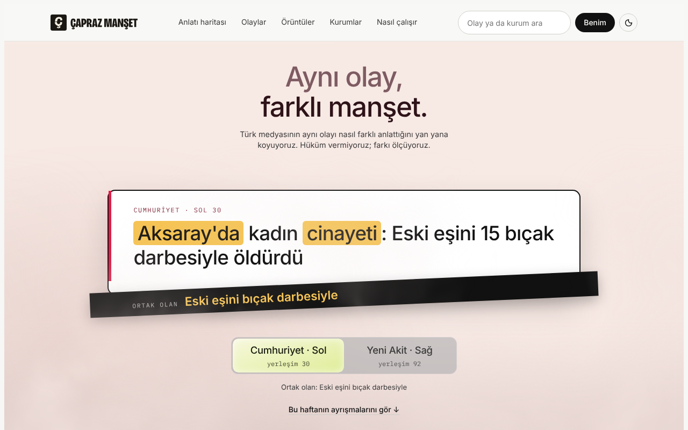

</div>

---

## Contents

- [Why this exists](#why-this-exists)
- [What you can do with it](#what-you-can-do-with-it)
- [A tour of the site](#a-tour-of-the-site)
- [How it works](#how-it-works)
- [Quick start](#quick-start)
- [Rebuilding the data](#rebuilding-the-data)
- [Project structure](#project-structure)
- [Front-end architecture](#front-end-architecture)
- [Methods in brief](#methods-in-brief)
- [Testing](#testing)
- [Accessibility and performance](#accessibility-and-performance)
- [Limits and responsible use](#limits-and-responsible-use)
- [Provenance and licence](#provenance-and-licence)

---

## Why this exists

When something happens in Türkiye, dozens of outlets publish it within hours, and they rarely say it the
same way. One calls a man a *"Holding Yönetim Kurulu Başkanı"*, another an *"İş insanı"*. One names who is
responsible, another leaves it out. One leads with the fact, another with the outrage.

Reading a single outlet hides these choices. **Çapraz Manşet** ("cross headline") makes them visible by
grouping headlines into events and laying them next to each other. Over a whole season of news it then
answers four plain questions with numbers:

| Question | Where on the site |
|---|---|
| Who reports what? Which events does one side of the spectrum barely cover? | Örüntüler › *Kim neyi haber yapıyor* |
| How is it told? How loaded is the language, and where do outlets diverge? | Örüntüler › *Nasıl anlatıyor* |
| Whom do the headlines hold responsible? | Örüntüler › *Kimi sorumlu tutuyor* |
| Who reports first, and is the headline harsher than the story's own lede? | Örüntüler › *Kim önce veriyor* |

It is written for three kinds of readers at once:

- **Everyday news readers** get one plain sentence and one picture.
- **Students and teachers** get "why it matters" and what a pattern does *not* mean.
- **Journalists and researchers** get the exact statistics, the method notes and the data table behind every chart.

### The data at a glance

| | |
|---|---|
| **Window** | 1 September to 3 November 2026 (Türkiye time) |
| **Headlines** | 245,935 from 33 outlets (181,274 with a lede), no sampling |
| **Events** | 5,341 groups of headlines about the same thing (5,201 automatic, 140 hand-checked) |
| **Placement** | each outlet's 0–100 position in a supplied registry: below 45 is left, above 55 is right (not independently verified) |
| **Validation** | event clustering pair-F1 0.845 against hand-made reference events; event-topic micro-F1 0.755 (`docs/build-report.json`) |

---

## What you can do with it

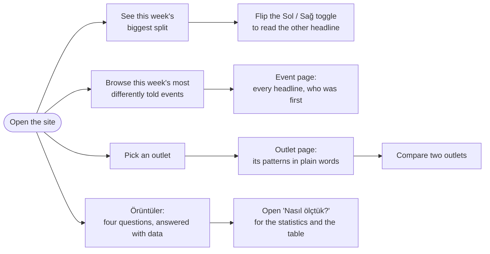

| Section | In plain words |
|---|---|
| **Anlatı haritası** | How outlets framed one event (which actor, which cause, which solution), as a flow, a network or a table. |
| **Olaylar** | Every event with search and topic filters, the events one side barely covered (*kör noktalar*), and a finder for official notices (*resmî ilanlar*). |
| **Örüntüler** | The four questions above, each answered by a few findings. |
| **Kurumlar** | Pick an outlet: a short summary, its most divergent recent headlines and its patterns. Compare any two. |
| **Nasıl çalışır** | Method, Türkiye-specific adjustments, a glossary, data coverage and the limits of all of it. |

---

## A tour of the site

### 1. The hero: one event, two headlines, through the fog

The homepage opens on **this week's biggest split**: of the events covered by both a left-placed and a
right-placed outlet, the one whose headlines differed most. The card shows one outlet's full headline with
its differing words highlighted. The black band underneath holds what both headlines share (*ortak olan*).

Press the glass **Sol / Sağ** toggle and the card sinks into a live fog, swaps to the other outlet's
headline while hidden, and rises back in the other side's light.

| Left outlet | Switching, in the fog | Right outlet |
|:---:|:---:|:---:|
|  | 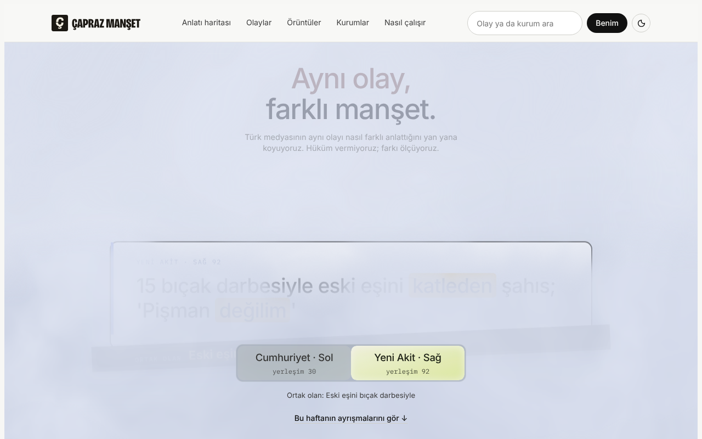 | 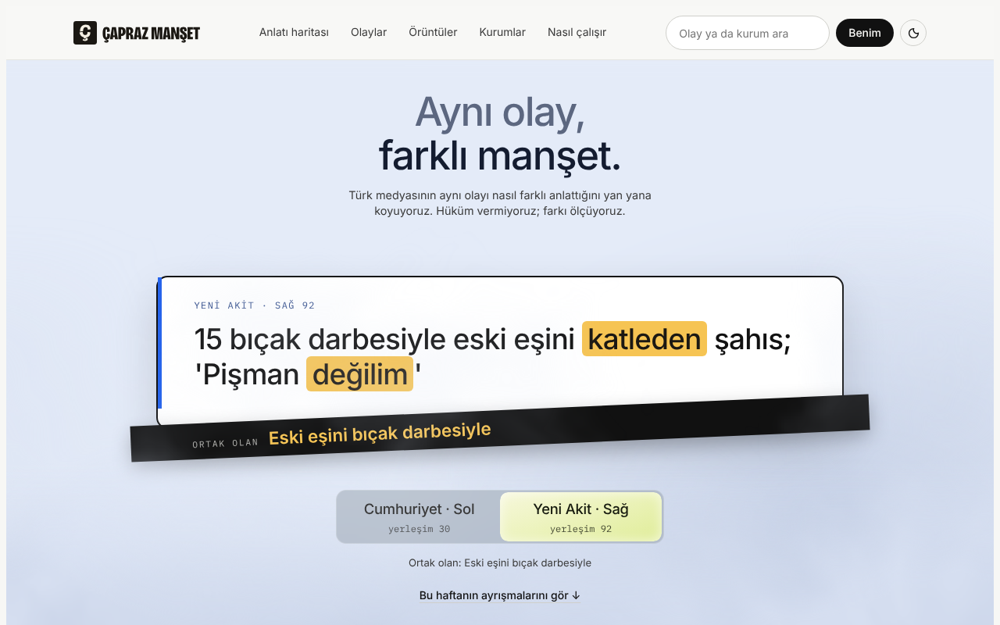 |

The fog is a small WebGL2 shader, with no video and no images. Every colour mixes on a single value, from
the left side's warm red-grey to the right side's cool blue-grey. With *reduce motion* switched on, the
toggle swaps instantly.

### 2. This week's splits

Right below the hero sit the week's most differently told events. Each is a compact split card with one
plain line about *what* differs ("Birinde belirgin biçimde daha sert bir dil var", "Sorumlu tutulan farklı")
and how many outlets covered it. Hover a card, or scroll it into view on a phone, and its highlighted words
crackle into dots and re-form.

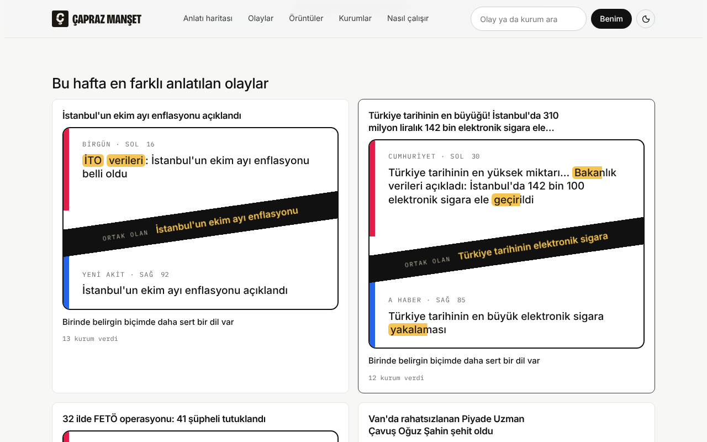

### 3. Every finding reads in three layers

Each finding on Örüntüler, Kurumlar and the outlet pages has the same shape:

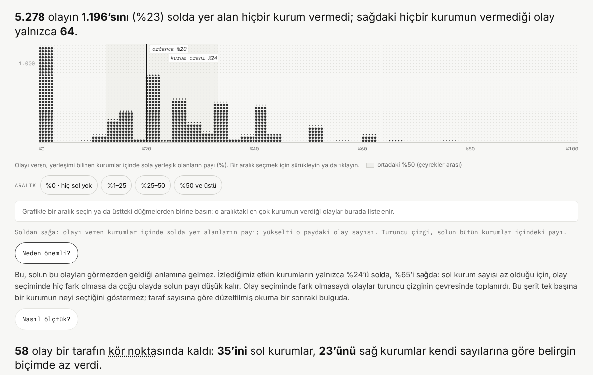

1. **Claim**: one sentence of about 25 words at most, with whole-number percentages and no statistical jargon.
2. **Chart**: interactive. Drag across a distribution to list its events, hover a line for a crosshair, re-sort rows. Charts are drawn as LED dot rows on canvas.
3. **Nasıl okunur**: one line on how to read the chart.
4. **Neden önemli?**: what the finding means, and what it does not mean.
5. **Nasıl ölçtük?**: the exact statistics (φ, ρ, p, 95 % intervals, n), method notes, and **Tabloyu göster**, the chart's data as a table.

Terms like *kör nokta*, *yerleşim* or *yüklü dil* are underlined. Tap one for a one-line definition from the
glossary.

### 4. Networks

Who picks the same events as whom, who reports after whom, and who blames whom are drawn as interactive
networks with [AntV G6](https://github.com/antvis/G6). The library is vendored in `public/vendor/g6.min.js`
and loads only on pages that need it.

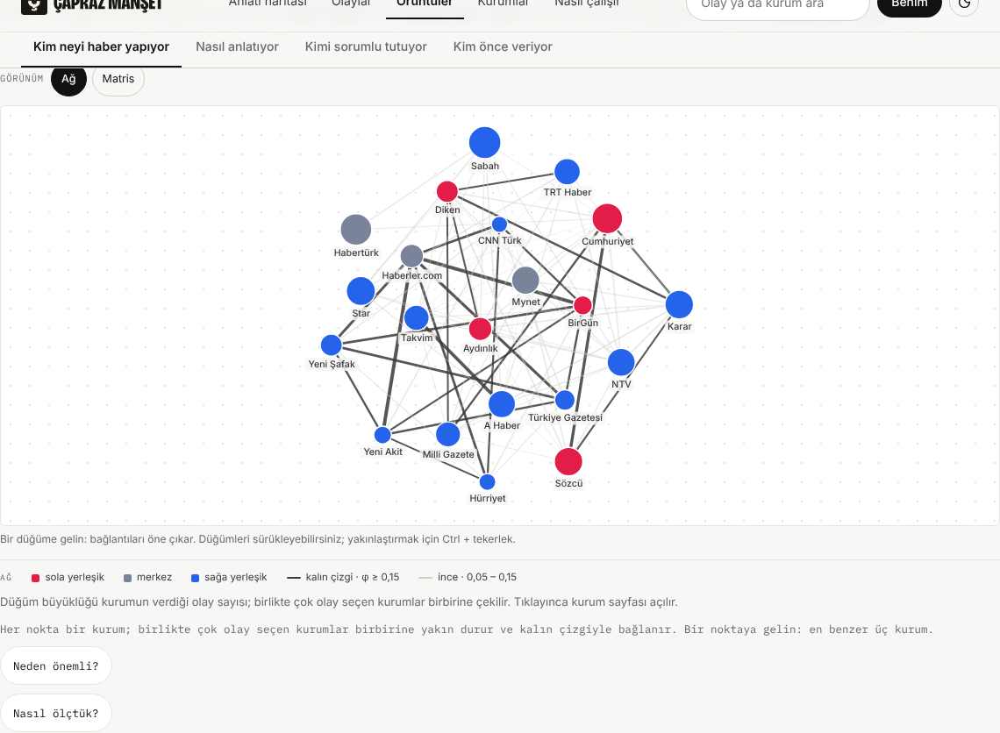

### 5. Event pages and outlet pages

| An event on a phone | An outlet |
|:---:|:---:|
| 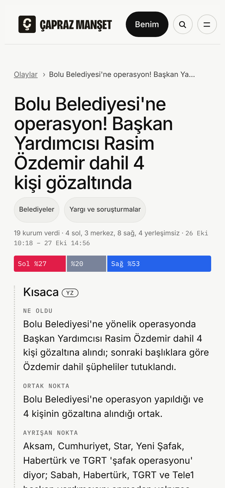 | 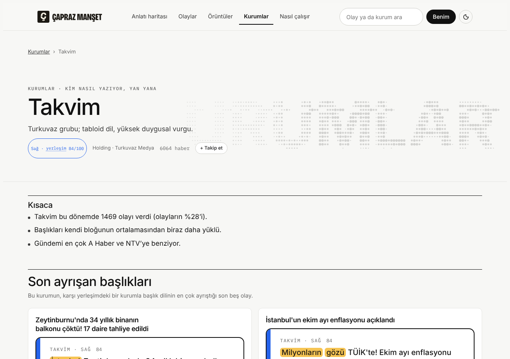 |

An **event page** reads story first:

- a one-line count, such as "19 kurum verdi · 4 sol, 3 merkez, 8 sağ, 4 yerleşimsiz";
- a short summary;
- the two most different headlines;
- every headline;
- who reported first.

The deeper layers (narrative coding, the AI review and similar headlines) are folded away.

An **outlet page** starts with three plain sentences: how much it covered, how loaded its headlines are
compared with its own bloc, and which outlets it resembles. Its most divergent recent headlines and its
patterns follow.

### 6. Light and dark

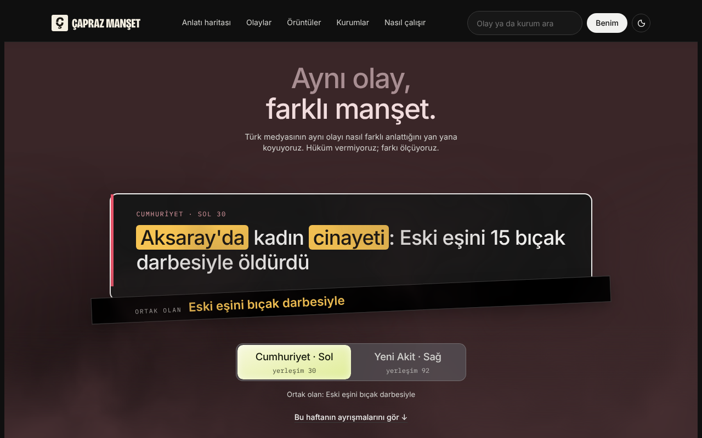

---

## How it works

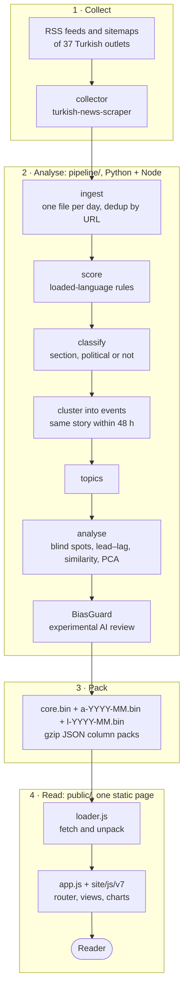

- The site has **no server**. `public/index.html` plus `public/data/*.bin` is the whole thing, and a new
  build only replaces the data packs.
- Ledes (the first paragraph of each story) live in separate monthly packs and load only when a page asks
  for them.

---

## Quick start

To view the site you only need Python 3. Rebuilding the data also needs Node 22 and Python 3.11+.

```bash
git clone https://github.com/aylinunel/caprazmansetnov26
```

```bash
cd caprazmansetnov26/public && python3 -m http.server 8000
```

Open <http://localhost:8000>. The first load unpacks about 35 MB of data and takes a few seconds.

Run the logic tests from the repository root:

```bash
node --test site/tests/logic.test.cjs
```

Run the smoke test, which drives the real site in Chromium (Playwright) at 1280 px and 390 px, in light and
dark themes:

```bash
node site/tests/smoke.cjs public /tmp/smoke
```

---

## Rebuilding the data

```bash
python -m pip install -r pipeline/requirements.txt jsonschema
```

```bash
cd pipeline && python -m capraz_pipeline run --from <collector export> --since 2026-09-01 --until 2026-11-03
```

`run` is `ingest` plus `build` plus `site`. Each step also runs on its own:

| Command | What it does |
|---|---|
| `python -m capraz_pipeline ingest --from DIR` | adds collector output to the day store (safe to repeat) |
| `python -m capraz_pipeline build` | runs every analysis stage and writes the data bundle |
| `python -m capraz_pipeline site --site ../public` | assembles `index.html` from `site/` and copies the data packs |

All parameters live in `pipeline/capraz_pipeline/config.py` and are published on the *Nasıl çalışır* page.
The stage-by-stage description is in [`pipeline/README.md`](pipeline/README.md) and
[ADR-0002](docs/adr/0002-analysis-pipeline.md).

<details>
<summary><b>The experimental AI review (BiasGuard)</b></summary>

```bash
python -m biasguard.news inputs --build dist/capraz-7/build --run runs/bg --top 150
```

```bash
python -m biasguard.news tasks --run runs/bg --stage select
```

Run the selector agents, then:

```bash
python -m biasguard.news tasks --run runs/bg --stage review
```

Run the advocate and skeptic agents, then:

```bash
python -m biasguard.news apply --run runs/bg --out dist/capraz-7/build/biasguard.json
```

Each of the most widely covered events is reviewed as one case: every outlet's first headline and lede
side by side, checked against a 116-concept catalogue by separate reviewer agents, an advocate and a
skeptic. A missing or invalid output is recorded as incomplete, never as "no bias". See
[`biasguard/AGENT_REVIEW.md`](biasguard/AGENT_REVIEW.md).

</details>

> **Never edit `public/index.html` by hand.** It is generated from `site/` by `pipeline/capraz_pipeline/site.py`.

---

## Project structure

```
caprazmansetnov26/
├── public/                 the built website: serve this folder
│   ├── index.html          generated single page (styles and scripts inlined)
│   ├── data/*.bin          gzip JSON packs: core, monthly articles, monthly ledes
│   └── vendor/g6.min.js    AntV G6 network library
├── site/                   website sources
│   ├── styles.css          all styles; later blocks override earlier ones
│   ├── head.html, logo.json
│   ├── js/loader.js        fetches and unpacks the data packs
│   ├── js/app.js           router, shared helpers, older views
│   ├── js/turkish-layer.js Turkish-language helpers and adjustments
│   ├── js/v7/*.js          current views and components (see below)
│   └── tests/              logic.test.cjs (node:test) and smoke.cjs (Playwright)
├── pipeline/               analysis pipeline (Python; the scorer runs in Node)
├── shared/analysis/        loaded-language rules, shared by the pipeline and the site
├── biasguard/              experimental AI review of events
├── data/reference/         hand-made reference events, labels and codings
├── runs/                   AI-coding task batches
└── docs/                   method notes, ADR, build report, specs, plans, images
```

---

## Front-end architecture

All view modules are concatenated into one script, in this order (`V7_ORDER` in
`pipeline/capraz_pipeline/site.py`):

| Module | Responsibility |
|---|---|
| `logic.js` | pure, unit-tested functions: redirects, weekly splits, "what differs", outlet summaries, Turkish suffixes, glossary |
| `core.js` | navigation, the **finding block**, glossary popovers |
| `graph.js` | G6 networks: agenda similarity, who follows whom, blame |
| `viz.js` | dot, interval and dumbbell rows, brushable distributions, line charts and data tables, drawn as LED dots |
| `dots.js` | dot-matrix engine for the page-header bands and the feed-card effect |
| `fog.js` | the homepage hero: split card, WebGL2 fog and the Sol/Sağ toggle |
| `home.js` | homepage: hero, weekly splits feed, how-it-works steps, go-deeper links |
| `anlati.js` | narrative map (flow, network or table) |
| `olay.js` | event page |
| `oruntu.js` | the four Örüntüler question pages |
| `kurum.js` | outlet findings |
| `yontem.js` | *Nasıl çalışır*: method, glossary, coverage, limits |
| `ilan.js` | official-notice finder |

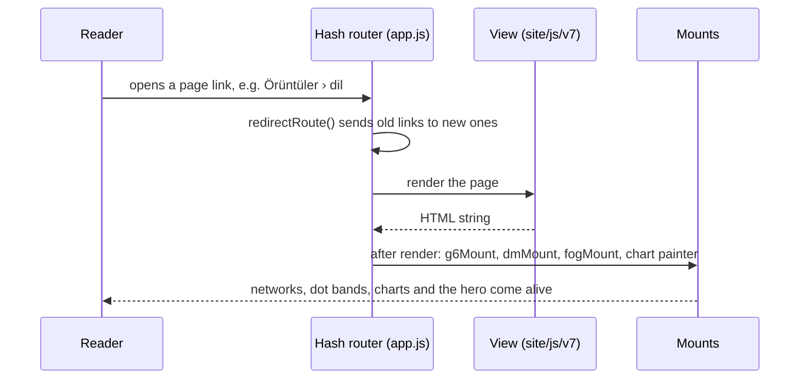

**Design tokens.** Off-white paper `#f7f7f5`, ink `#111111`, Inter for text and IBM Plex Mono for numbers.
Placement colours are fixed across the site (left `#E11D48`, right `#2563EB`, centre `#79839A`), and a
yellow highlight marks differing words. Every colour is a CSS variable with light and dark values.

---

## Methods in brief

| Measure | How | Key parameters |
|---|---|---|
| **Event** | headlines grouped by TF-IDF cosine similarity within a time window | cosine ≥ 0.33, 48 h window, 40 % linkage, at most 120 headlines, at least 5 outlets |
| **Placement and bloc** | registry position from 0 to 100 | left below 45, right above 55, otherwise centre; unplaced outlets kept separate |
| **Loaded language** | rule-based scorer giving each headline and lede 0–100 | rules in `shared/analysis/rules.cjs`; "loaded" means 25 or more |
| **Blind spot (kör nokta)** | one side covered an event markedly less than its number of active outlets predicts | binomial test, p < 0.10 |
| **Who's first** | each outlet's first headline per event, and its lag behind the first publisher | 48 h horizon |
| **Agenda similarity** | φ correlation of which events two outlets covered, with a Mantel test against placement | 9,999 permutations |
| **Writing style** | PCA over how often each framing structure appears, per outlet | Spearman ρ with placement |
| **Narrative coding** | nine dimensions (frame, blame, solution and others) per outlet per event; the first six weeks coded by hand, later weeks by an AI agent and marked **YZ** | see *Nasıl çalışır* |

Every number on the site is computed from the data at page load. Nothing is typed in by hand.

---

## Testing

| Suite | Command | What it covers |
|---|---|---|
| Logic | `node --test site/tests/logic.test.cjs` | 21 tests: redirect table, weekly splits, "what differs" rules, outlet summary bands, Turkish suffixes, glossary wrapping |
| Smoke | `node site/tests/smoke.cjs public <outDir> [routes…]` | every route at 1280 px and 390 px, light and dark: no console errors, no horizontal scroll, event-page section order, no statistical jargon in finding claims, a table for every chart, 44 px touch targets, glossary keyboard access, the hero toggle, feed behaviour, chart labels never clipped |
| Pipeline | `cd pipeline && python -m unittest discover -s tests` | offline pipeline tests |

---

## Accessibility and performance

- **Touch, mouse and keyboard all work.** Touch targets are at least 44 px on phones, focus rings are
  visible, line charts take arrow keys and Esc closes popovers. Anything that links opens on the first tap.
- **Contrast** is at least 4.5 : 1 for text in both light and dark themes.
- **Reduced motion is respected everywhere.** The hero swaps instantly, dot effects show still frames and
  charts don't animate.
- **Colour is never the only signal.** Placement is also written out (*sol / merkez / sağ*), and differing
  words are also highlighted.
- **Animation is cheap.** Canvases run at no more than 30 fps and stop when off-screen. The hero releases
  its WebGL context when you leave the page, and the network library loads only where it's needed.

---

## Limits and responsible use

- **Placements are supplied, not verified.** The 0–100 positions come from a registry, and the site treats
  them as claims.
- **Patterns are not verdicts.** A loaded word, a blind spot or a missing blame is a difference worth
  seeing, not proof of intent or error. Every finding says so in *Neden önemli?*.
- **Machine output is labelled.** Automatic results say *otomatik*, and AI-made content carries a **YZ**
  badge. The AI review (BiasGuard) is experimental: two reviewer agents of the same model are not
  independent, and an unreviewed event is never shown as bias-free.
- **There are coverage gaps.** 29–30 October are missing from the collector, and 4 November was a partial
  day and is left out.

---

## Provenance and licence

See [`NOTICE.md`](NOTICE.md). In short:

- Outlet placements, ownership notes, narrative codings and hand-checked events are supplied material,
  carried unchanged.
- The collector comes from [`aylinunel/turkish-news-scraper`](https://github.com/aylinunel/turkish-news-scraper),
  whose redistribution licence is unknown.
- No licence is asserted for this repository. Resolve permissions before redistributing it publicly.
